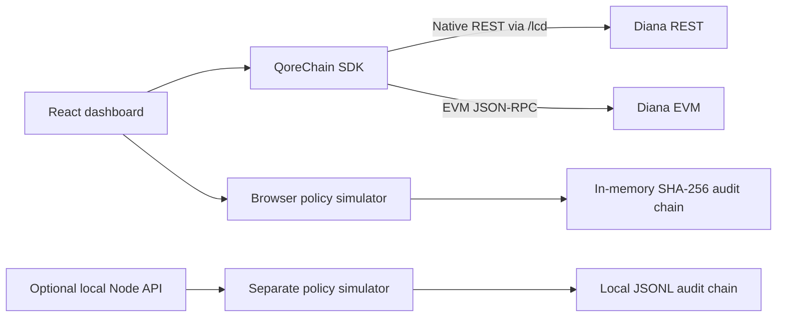

# Q-Day Shield — Phase 1 Source Code Audit

**Audit date:** 2026-11-17  
**Scope:** Read-only inspection of the tracked project source, configuration, documentation, tests, and installed `@qorechain/sdk` 0.14.0 declarations. No source changes were made during inspection. No live network calls were made for this source audit.

## 1. Executive summary

Q-Day Shield is a **read-only Diana testnet dashboard plus a separate local security simulator**. It is not a wallet, transaction authorization system, on-chain policy engine, or PQC cryptographic verifier. The UI clearly labels much of the simulation as demo/mock data, and source inspection found no wallet connection, signer invocation, transaction broadcast, or contract deployment path.

The Native REST and EVM JSON-RPC monitor is substantially implemented: it checks the expected Native chain ID and EVM chain ID before dependent reads, validates many response fields, bounds requests with timeouts/retries, and separates unavailable/stale values from successful observations. Its tests use injected mocked responses. The repository documentation records that prior live connectivity attempts failed; this audit did not repeat them, so no live endpoint fields are newly verified here.

The highest-impact risks are product-boundary risks: dashboard controls do not protect real transactions; the optional API uses demo identities and approval labels, and remote mode does not itself provide TLS or per-user roles; and the hybrid evidence parser corroborates endpoint-returned evidence but does not verify the ML-DSA signature cryptographically. Those limitations are partly documented and should remain prominent in any deployment or public description.

The browser overview’s security metrics and charts are static demonstration values. The browser policy engine is real deterministic code, but its inputs and outcomes are local simulation data. The separately implemented API is not used by the dashboard. Browser audit records are session-only; the API has local JSONL persistence and hash-chain consistency checks, but no keyed/external anchor, multi-process lock, or privileged-tamper resistance.

**Verification performed for this audit:** `npm.cmd run typecheck` passed; `npm.cmd test` passed, 39/39. Production build was not run because it writes generated files into `dist/`, while this audit was limited to creating this report. No live connectivity test was run.

## 2. Existing architecture overview

- `src/App.tsx` owns the browser session, SDK client, monitor state, balance/tokenomics reads, and demo policy engine.
- `src/network/qorechainMonitor.ts` performs Native REST and EVM JSON-RPC reads. The REST browser path uses the Vite `/lcd` proxy; the EVM path uses the pinned Diana RPC endpoint.
- `src/security/` contains fake identity construction, deterministic policy decisions, an in-memory audit chain, and a fixed-fixture EVM authorization-window evaluator.
- `server/` is an optional independent Node HTTP API. It runs its own simulation engine and local file audit store. The dashboard does not call these routes.
- `tests/run-tests.mjs` compiles the TypeScript core to a temporary directory and runs Node tests against injected/mock transports and local temporary audit files.

## 3. Complete feature inventory

| Feature | Finding | Status |
| --- | --- | --- |
| Dashboard navigation, responsive presentation, status cards | Implemented; browser/device/accessibility QA is absent. | Implemented / unverified visually |
| Overview security posture, policy count, approval count, audit integrity, activity/risk charts | Hard-coded illustrative/demo data; not calculated from live or simulator events. | Simulated |
| Native Diana identity and height | SDK `getLatestBlock`; validates chain ID and positive decimal height. | Implemented; live field unverified |
| EVM chain identity and height | SDK EVM `ethChainId()` and `ethBlockNumber()`; validates hex quantities and expected chain ID. | Implemented; live field unverified |
| Protocol feature reads | SDK method after both identities match; response height/features checked. | Implemented; live field unverified |
| Public Native account reads | Public `qor1` validation; PQC status, balances, sender transaction history, and EVM window via documented SDK methods. | Implemented; live field unverified |
| EVM-address account reads | No EVM address input or EVM account balance/history UI is wired into the app. EVM RPC is used for network identity/height. | Missing |
| Hybrid verification evidence | Indexed event plus transaction lookup and signature-extension shape check; no local signature verification. | Partial / endpoint evidence |
| Tokenomics | `client.qor.getTokenomicsOverview()` exists in installed SDK types and is called after identity checks. No tokenomics-specific test or live verification is present. | Partial / unverified |
| Attack simulator | Fake identity, simulated classical compromise marker, fixed action, deterministic local decision. | Simulated; tests cover core rules |
| Policy allowlist, limits, replay, pause | Enforced by local `SecurityPolicyEngine` for simulated actions only. | Implemented simulation |
| Human approval | Browser policy core supports a fingerprint-bound continuation. API uses a fixed `demo-approver`; no authenticated reviewer identity or cryptographic approval exists. | Simulated |
| Browser audit | In-memory SHA-256 chain, local verification UI, session-only. | Implemented locally |
| API audit | JSONL + sequence/hash links, restart restore, tamper detection against in-process state. | Implemented locally; not immutable/anchored |
| API integration | Routes exist but browser app does not call them. | Partial / separate |
| Identity, roles, sessions | Static demo operator labels; no user login, session authorization, or RBAC. | Missing |
| Signing/broadcast/deployment | No application flow found. | Missing by design |

## 4. File-by-file findings

### UI and display

| File | Evidence and audit finding |
| --- | --- |
| `src/App.tsx` | `demoEvents` (line 24) and `OverviewPage` (lines 195–203) use fixed metrics: “Guarded”, 1,284 checks, 03 approvals, demo audit integrity, static event feed, and risk chart inputs. All are labeled mock/illustrative; none are derived from verified security events. `loadBalance` (139–151) checks both network identities before SDK balance read, but the balance state stores no queried address; changing the input after a successful read can leave the old account’s balance visible under the newly entered address. `loadTokenomics` (153–164) calls an SDK-declared method after identity checks. The browser creates its own `SecurityPolicyEngine` (line 39); it does not call the backend API. |
| `src/SecurityViews.tsx` | `SecuritySimulatorPage` (30 onward) displays a fake identity and simulated compromise. `localDisplayEvents` (23–28) is static sample content. `PolicyCenterPage` (62 onward) changes only the browser engine and labels it simulated. `SecurityAuditPage` (around 83 onward) verifies the in-memory log and separately displays a static sample feed. No export control is present. |
| `src/QoreChainMonitorView.tsx` | Renders Native/EVM observations, source labels, public Native address, transaction history, window status, and event evidence. Account/global scope is displayed; stale values are identified as stale rather than live. The event UI states that signature verification is not local. |
| `src/EvmWindowDemo.tsx` | Uses fixed mock accounts/transactions and the local `evaluateMockEvmTransaction` evaluator; it does not consume live EVM observations as transaction decisions. |
| `src/components.tsx` | Shared badge, chart, status, empty-state and freshness components. Charts accept supplied static arrays; no event aggregation/query source is implemented here. |
| `src/styles.css` | Contains responsive breakpoints and reduced-motion/focus styling. This audit did not run browser, screen-reader, contrast, or visual-regression checks. |
| `src/main.tsx` | React root bootstrap only; no identity/session boundary is established. |
| `index.html` | Static Vite page shell; no security backend or identity mechanism. |

### Network integration and SDK boundary

| File | Evidence and audit finding |
| --- | --- |
| `src/network/qorechainMonitor.ts` | Pins `qorechain-diana`, EVM 9800, REST, and EVM RPC (18–24). `refreshQoreChainObservations` verifies Native header ID and EVM chain ID before dependent reads (138–205). Public addresses use SDK `isValidBech32`; account transactions use `searchTxs` with ten-row pages (304–324). Window response fields are strictly validated (400–411). `observe` retries once, maps malformed/timeout/HTTP failures to unavailable, and retains old values only as stale (420 onward). Event parsing checks transaction code, matching positive event and extension type/signature length (336–395); it does not decode and cryptographically verify the signature or validate extension `algorithm_id`. The `result=pass` acceptance path is implemented but its provenance is not established by the repository’s test fixtures or documented evidence reviewed here. |
| `vite.config.ts` | Proxies `/lcd` to `https://api-testnet.qore.host`; `/api` proxies to the optional local API. This is development/preview proxy configuration, not a production deployment architecture. |
| `src/vite-env.d.ts` | Declares `VITE_QORE_REST_URL` and `VITE_QORE_EVM_RPC_URL`; the app uses hard-coded/pinned endpoints instead. These declarations appear unused and can mislead configuration maintainers. |
| `scripts/check-testnet.mjs` | Manually invoked read-only script. One optional positional argument is a Native `qor1…` address; if omitted, it reads `QORE_PUBLIC_TEST_ADDRESS`. It checks Native REST block ID/height and EVM chain ID/height, then gates feature/account/event reads on identity. It does not accept an EVM account address. Some response validation is less strict than the TypeScript monitor: the Native height regex coerces rather than first requiring a string, and malformed EVM quantities can escape parsing to the top-level catch instead of producing independent per-field status. No live execution was performed for this audit. |
| `node_modules/@qorechain/sdk/dist/index.d.ts` | Installed SDK is 0.14.0. Types document `getLatestBlock`, `searchTxs`/`SearchTxsOptions`, `RestClient.getAllBalances`, `getPqcAccount`, `JsonRpcClient.ethChainId`, and `ethBlockNumber`. The `QorClient` type declares `getTokenomicsOverview()` for `qor_getTokenomicsOverview` (around line 478); therefore the method is not absent from the installed type surface. Runtime endpoint availability is not proven by a declaration. SDK also contains PQC key/sign/verify APIs, but app source does not invoke local key generation/signature verification. |

### Simulation and security core

| File | Evidence and audit finding |
| --- | --- |
| `src/security/types.ts` | Types distinguish fake identities, simulated transfers, local policy decisions, and audit records. These types do not represent signed chain transactions or authenticated users. |
| `src/security/simulation.ts` | `createFakeTestIdentity`, `simulateClassicalKeyCompromise`, and `createSimulatedTransfer` create inert local objects; compromised state is a marker. No private key is created/read. |
| `src/security/policyEngine.ts` | `SecurityPolicyEngine` checks pause, expiries, fake identity, compromised/classical signer markers, recipient, amount, cumulative/per-action/count limits, replay and approval (118–194). It serializes evaluations and writes audit records. It is not wired to chain submission. Approval identity is only a nonempty string/fingerprint check in the core; this is not user authentication. The UI scenario uses a fixed disallowed recipient, so its normal action is denied before approval is actionable. |
| `src/security/auditLog.ts` | Browser `TamperEvidentAuditLog` canonicalizes JSON and SHA-256 chains entries (append/verify). It is memory-only and has no external keyed checkpoint, durable persistence, export, or independent time source. |
| `src/security/evmWindowSimulation.ts` | Fixed fixture evaluator with no RPC/wallet imports. Potential input-validation gap: exported `evaluateMockEvmTransaction` sums `transferValueUqor + maxFeeUqor` without rejecting negative values; current UI uses fixed positive fixtures, so this is confined to callers of the exported simulation helper. |
| `src/security/index.ts` | Barrel exports security simulation/core modules; no wallet or QoreChain signer wiring is present. |

### Backend, scripts, configuration, docs, tests

| File | Evidence and audit finding |
| --- | --- |
| `server/app.ts` | Config defaults to loopback and validates port, remote opt-in/token length, and audit directory (15–28). Routes include health, not-collected observation, policy snapshot, audit verify/events, pause, simulated decisions/approval/scenario (47 onward). `authorizeSensitive` uses a shared bearer token only when remote mode is enabled and a per-IP/kind in-memory limiter (110–121). Approval actors are fixed demo labels; pending actions live in a process-local `Map` (37, 86–97). The engine restores pending fingerprints from audit on restart, but the API pending-action map is not restored, so a persisted pending approval cannot be resumed after restart. Every request verifies the whole audit file before routing, making request cost grow with log size. |
| `server/auditStore.ts` | Appends JSONL with sequence, previous hash and SHA-256 (63–77), restores/checks records, and detects edits/reordering/truncation relative to in-process history (84–119). Hashes are unkeyed and not externally anchored; a full file rewrite before process initialization can create a new internally consistent chain. The queue and sequence are process-local; there is no inter-process lock. |
| `server/contracts.ts` | API types explicitly mark policy/simulation/audit sources as demo and QoreChain observations as `not-collected`; this avoids claiming backend live data. |
| `server/main.ts` | Starts the API listener based on config; no built-in TLS listener. Remote mode therefore depends on an external TLS-terminating proxy/network layer. |
| `server/node-shims.d.ts` | Local Node type shims; no runtime security behavior. |
| `scripts/run-api.mjs` | Compiles server/security source into a temporary directory, loads `QDAY_` environment values for the child, runs server, and cleans temporary output. No browser/API state synchronization is implemented here. |
| `scripts/build.mjs` | Invokes Vite production build with React plugin; it writes generated `dist` assets. Not run during this audit to avoid changing generated files under the “only create report” constraint. |
| `tests/run-tests.mjs` | Compiles security/network/server TypeScript into a temporary directory and runs four Node test files; cleanup is guarded to the expected temporary directory. It does not compile/test React UI behavior. |
| `tests/network.test.mjs` | Mock-fetch tests cover identity gating, invalid/malformed responses, account parsing/pagination, event filter fallback/scope, endpoint errors, stale values and timeouts. Mocks do not demonstrate live endpoint behavior. |
| `tests/policyEngine.test.mjs` | Covers deterministic allows/denies, limits, replay, pause, approval continuation and in-memory audit tampering; no real signature, wallet, concurrency across processes, or on-chain enforcement tests. |
| `tests/api.test.mjs` | Exercises API validation, rate limits, audit persistence/restart/tampering, and fail-closed behavior. It does not test dashboard-to-API integration or authenticated distinct approvers. |
| `tests/evmWindow.test.mjs` | Covers fixed mock window cases; no live EVM admission or transaction path. |
| `README.md` | Describes simulation/live boundaries and explicitly says the browser does not call the API. Feature descriptions should continue to distinguish endpoint evidence from cryptographic verification. |
| `SECURITY.md` | Documents no signing, demo-only policy, audit limitations, and remote API limitations. The acknowledged remote TLS requirement is not enforced by the server itself. |
| `ARCHITECTURE.md` | Documents separation of browser simulation, backend simulation, and read-only monitor. Does not claim production authorization. |
| `DEMO.md` | Demo script uses fake identities and mock values; advises against presenting sample activity as observed activity. |
| `TESTING.md` | Records mocked test coverage and prior live-check failure; test suite is offline. |
| `package.json` / `package-lock.json` | Scripts define test/typecheck/build and separate manual `testnet:check`; dependencies include `@qorechain/sdk` 0.14.x, React, Vite, TypeScript. No separate UI/E2E, lint, fuzz, or vulnerability audit script is configured. |
| `.env.example` / `.gitignore` | Example configuration and ignore rules are present. The real `.env` was not opened or printed; secret contents were not audited. |

## 5. Confirmed bugs and potential issues

Severity definitions here reflect likely impact if a capability is misunderstood or exposed; the repository itself labels the major simulation boundaries.

### F-01 — Overview account balance is not bound to the address that was queried

- **Severity:** Medium
- **Status:** Broken (display-state association)
- **Evidence:** `src/App.tsx`, `loadBalance` (139–151) stores only `Balance[]` and timestamp. `ReadPanel` (232–234) keeps the address input editable while showing the existing success state and does not display the queried address.
- **Impact:** After one successful read, changing the public address can leave the prior address’s balance visible with the new address in the input.
- **Recommended fix:** Store the queried address alongside each balance result; clear or visibly mark it stale when the input changes; render the address associated with the result.
- **Required verification:** UI test reads account A, changes input to B without reading, and confirms A’s balance is labeled A/stale and never attributed to B.

### F-02 — Remote API can be bound without built-in TLS or user-level authorization

- **Severity:** High if remote mode is exposed; otherwise Low for loopback demo
- **Status:** Partial
- **Evidence:** `server/app.ts`, `loadApiConfig` (15–28) permits non-loopback with `QDAY_ALLOW_REMOTE=true` and a shared bearer token. `authorizeSensitive` (110–121) has no user/role model. `server/main.ts` listens with Node HTTP and has no TLS configuration. `SECURITY.md` delegates TLS to deployment.
- **Impact:** If exposed directly over an untrusted network, the bearer token is not protected by this process’s transport; anyone holding the shared token has the same simulated operator/approval permissions.
- **Recommended fix:** Keep loopback-only unless deployed behind verified TLS; add per-user authentication/authorization and separate approver identity before any non-demo use; do not describe this API as a transaction authority.
- **Required verification:** Deployment security test confirms HTTPS termination, no plaintext remote route, authorization separation, token rotation, and denied unauthenticated operations.

### F-03 — Approval is a demo continuation, not an authenticated human approval

- **Severity:** High if interpreted as a real control; Medium within the labeled simulator
- **Status:** Simulated
- **Evidence:** `server/contracts.ts` fixes `ApprovalRequest.approvedBy` to `demo-approver`; `server/app.ts` accepts that literal (86–97). `src/security/policyEngine.ts`, `isValidApproval` (198–211), checks the caller-supplied name/fingerprint/time but no identity credential. Browser approvals have no authenticated approver session.
- **Impact:** Anyone with access to the demo API can present the expected label; no distinct human or cryptographic approval is established.
- **Recommended fix:** Keep this explicitly demo-only. A production approval flow needs authenticated actors, policy authorization, immutable action binding, expiry/revocation, and auditable identity proofs.
- **Required verification:** Negative tests for forged/reused approvers, actor separation, changed payload, expired approval, unauthorized roles, and concurrent replay.

### F-04 — Persisted pending approvals cannot be resumed after API restart

- **Severity:** Medium
- **Status:** Broken (restart workflow)
- **Evidence:** `server/app.ts` restores engine state from `FileAuditStore` in `initialize` (41–45), but pending action payloads are held only in `pending` map (37) and are not reconstructed. The approval route requires that map entry (92–96). `SecurityPolicyEngine.restoreFromAudit` does restore pending request IDs/fingerprints (`src/security/policyEngine.ts`, 66–88).
- **Impact:** After restart, the engine may consider a request pending while the route returns 404 because the corresponding action is absent from the process-local map.
- **Recommended fix:** Persist the full pending action in a validated durable workflow record or cancel pending requests during restart with an explicit audited terminal state.
- **Required verification:** Integration test creates pending approval, restarts API, then confirms documented resume or safe cancellation behavior.

### F-05 — Hybrid evidence status can be mistaken for local PQC verification

- **Severity:** Medium
- **Status:** Partial
- **Evidence:** `src/network/qorechainMonitor.ts`, `readVerificationEvents` (336–395) requires a successful returned transaction code, matching returned event, and extension type URL plus Base64-decodable 4,627-byte signature. `isMlDsa87SignatureBase64` checks encoding/length only (around 469). It does not call SDK `pqcVerify`, validate `algorithm_id`, or verify a signature against a public key/message. `VerificationEvent.status` uses the name `verified` and one path accepts `result=pass` (around 353–360). UI does disclose endpoint evidence and no local cryptographic verification (`src/QoreChainMonitorView.tsx`).
- **Impact:** The code establishes structural corroboration of node-returned fields, not independent proof that the PQC signature is cryptographically valid. An unexpected extension algorithm with a same-length payload is not excluded by the parser.
- **Recommended fix:** Rename the derived state to `corroborated-endpoint-evidence` or equivalent; check documented algorithm identifier/type fields; treat event fields as node claims. Only add local verification if official byte/signature semantics and verification inputs are documented and tested.
- **Required verification:** Tests for wrong/missing algorithm ID, malformed/noncanonical Base64, wrong signature length, wrong public key/message, event/transaction mismatch, failed transaction code, and endpoint-only evidence labeling.

### F-06 — Browser policy state does not enforce API or blockchain actions

- **Severity:** High if represented as real protection; Medium for the clearly labeled demo
- **Status:** Simulated / separate
- **Evidence:** `src/App.tsx` creates an in-memory `SecurityPolicyEngine` (39) and passes its controls to `PolicyCenterPage` (185). The API is only proxied/configured; no frontend fetch to `/api` exists in `src/`. `src/security/policyEngine.ts` consumes `SimulatedTransfer` and fake identities; no transaction submitter is connected.
- **Impact:** Allowlist, limits, approval, pause and decisions protect only fake local actions. They cannot block a QoreChain/EVM transaction.
- **Recommended fix:** Preserve the explicit demo boundary. If real enforcement is ever in scope, design an independently secured signing/authorization service and on-chain controls; do not bridge this engine directly to signing without a separate threat model and review.
- **Required verification:** Architecture/integration tests prove simulation UI is not presented as live enforcement; any future enforcement must test the actual transaction admission path.

### F-07 — Persistent audit chain is tamper-evident only against partial/unanchored edits and has no process lock

- **Severity:** Medium
- **Status:** Partial
- **Evidence:** `server/auditStore.ts`, `hashRecord` (11–12), `append` (63–77), and `verify` (84–119) use unkeyed SHA-256 and in-process record comparison. `FileAuditStore` uses only an instance-local queue (31, 128); no lock file/database transaction coordinates multiple API processes. `SECURITY.md` documents these limitations.
- **Impact:** Full-file rewrite before startup can produce a new internally valid chain; concurrent processes sharing a directory can race sequence/hash appends. It is not immutable evidence.
- **Recommended fix:** Use a single-writer store or inter-process lock/transactional database, plus signed/external append-only checkpoints and off-host backup for stronger evidence.
- **Required verification:** Multi-process append stress test; full-file rewrite threat test; external checkpoint verification and recovery tests.

### F-08 — Audit verification is repeated over the entire JSONL file on each API request

- **Severity:** Medium
- **Status:** Implemented with scalability risk
- **Evidence:** `server/app.ts`, `route` (47–50) invokes `store.verify()` before dispatching every request. `server/auditStore.ts`, `verify` (84–119) rereads and reparses all persisted lines.
- **Impact:** Request work and disk I/O grow linearly with audit history; this can degrade or exhaust a remotely exposed demo API as the log grows.
- **Recommended fix:** Bound/compact history with anchored checkpoints, verify incrementally against a safe checkpoint, and enforce request/concurrency limits at the server boundary.
- **Required verification:** Load test with increasing audit sizes and test that integrity checks remain fail-closed while bounded in latency/resource use.

### F-09 — EVM account identity, balance, and history are not observed by the UI

- **Severity:** Low (capability gap)
- **Status:** Missing
- **Evidence:** `src/App.tsx` defines one `qor1` address state and reads Native balances; EVM integration in `src/network/qorechainMonitor.ts` checks chain ID/height and reads an EVM window keyed by the Native account. No EVM address input, `eth_getBalance`, `eth_getTransactionCount`, `eth_getCode`, or EVM transaction-history UI is wired.
- **Impact:** “EVM monitor” means network identity and Native-address authorization-window status, not general EVM account observation.
- **Recommended fix:** Clarify product labels. Add public EVM account reads only if needed, through supported read methods and strict address/network validation.
- **Required verification:** Mock tests for EVM address validation, chain gating, balances/nonces/code, malformed RPC output, and zero-vs-unavailable distinctions.

### F-10 — The EVM mock evaluator accepts negative transfer/fee inputs

- **Severity:** Low
- **Status:** Partial (input validation gap in exported simulator helper)
- **Evidence:** `src/security/evmWindowSimulation.ts`, `evaluateMockEvmTransaction` calculates total at entry and checks upper bounds but never rejects negative `transferValueUqor` or `maxFeeUqor`.
- **Impact:** A caller outside the current fixed-fixture UI could receive an allowed simulated result for an invalid negative input.
- **Recommended fix:** Reject negative value/fee (and invalid target) before computing a decision.
- **Required verification:** Unit tests for each negative operand, zero values, and valid boundary values.

### F-11 — Static overview values are illustrative, not operational metrics

- **Severity:** Medium (misrepresentation risk if labels are removed)
- **Status:** Simulated
- **Evidence:** `src/App.tsx`, `OverviewPage` (199–203), `OverviewVisuals` (206 onward), and `demoEvents` (24 onward) hard-code posture, 1,284 checks, 03 approvals, risk percentages, chart series, and sample timeline rows. `src/SecurityViews.tsx`, `localDisplayEvents` (23–28) supplies a static feed.
- **Impact:** These values do not measure chain activity, policy engine decisions, or actual pending approvals. The current UI labels them mock/illustrative.
- **Recommended fix:** Retain conspicuous labels; replace only with real sourced aggregates when event provenance and time windows are defined.
- **Required verification:** Component tests assert source labels and ensure no static metric is exposed as live.

### F-12 — Balance success state is not covered by a UI or identity-association test

- **Severity:** Low
- **Status:** Missing test coverage
- **Evidence:** Existing tests are `tests/api.test.mjs`, `tests/network.test.mjs`, `tests/policyEngine.test.mjs`, and `tests/evmWindow.test.mjs`; `tests/run-tests.mjs` does not compile or mount React components. No test covers overview/monitor balance state after address edits.
- **Impact:** UI data attribution and source-label regressions are not caught by the current suite.
- **Recommended fix:** Add focused component tests for address/result association, loading/error/empty/stale states, and source labels.
- **Required verification:** UI test suite covering those state transitions.

## 6. Mock/demo/simulation inventory

- **Overview:** “Guarded”, 1,284 policy checks, 03 pending approvals, audit “Demo”, synthetic policy activity chart, fixed risk distribution, and four-entry event feed are hard-coded in `src/App.tsx`.
- **Attack exercise:** Fake `qday-demo://` identity, simulated compromise marker, fixed action amount/recipient, deterministic denial; no key or attack execution (`src/security/simulation.ts`, `src/App.tsx`, `src/SecurityViews.tsx`).
- **Policy controls:** Demo allowlist, spending caps, approval threshold, pause, and replay state run only in local memory (`src/security/policyEngine.ts`, `src/App.tsx`).
- **EVM window lab:** Fixed mock heights/accounts/window and transactions (`src/security/evmWindowSimulation.ts`, `src/EvmWindowDemo.tsx`).
- **Audit UI sample feed:** Static illustrative content is separate from live in-memory records (`src/SecurityViews.tsx`).
- **API:** Every policy/scenario/approval/audit action is simulation/demo; QoreChain observation route explicitly returns `not-collected` (`server/contracts.ts`, `server/app.ts`).
- **Tests:** Network and policy tests inject fake responses/actions. Passing tests establish local behavior under those fixtures, not live network correctness or production security.

## 7. QoreChain integration findings

- The client is configured for the SDK `testnet` preset, Native REST `/lcd` proxy, and pinned EVM endpoint (`src/App.tsx`, `vite.config.ts`). Monitor `assertDianaConfiguration` rejects the mainnet REST host and unpinned EVM endpoint (`src/network/qorechainMonitor.ts`).
- Native identity is taken from the latest REST block header (`chain_id`, `height`, optional `time`) and matched to `qorechain-diana`. EVM identity/height use SDK `ethChainId`/`ethBlockNumber`, parsed as hex quantities and matched to 9800.
- If either identity fails or mismatches, dependent protocol/account/event reads are marked unavailable. Balance/tokenomics loaders also gate their read on both identities.
- Public account data is Native-address-centric: PQC record/status, balances, sender tx pages, event search, and EVM window. The app does not model a paired EVM address or EVM account history.
- `searchTxs` supports paginated sender history. Hybrid event search is limited to latest ten results per filter, and if account-index filtering throws, code falls back to global events. The UI records the resulting scope; the catch path can treat transient account-query errors as index unavailability if global queries then succeed.
- `getTokenomicsOverview` is present in the installed SDK declaration as `qor_getTokenomicsOverview`; this disproves a claim that the method is absent from the installed type surface. Whether the public Diana endpoint currently supports/responds to it remains unverified. The method has no dedicated mocked test in this suite.
- Repository docs record prior REST/EVM connectivity failure. No live chain field is claimed verified by this audit.

## 8. PQC implementation status

- The SDK dependency includes key-generation, signing and verification APIs, but app imports/calls do not use `generatePqcKeypair`, `pqcSign`, or `pqcVerify`.
- `fetchPqcStatus` reports endpoint-returned registration, algorithm ID, and possession status; these are observations, not locally verified proof-of-possession.
- Native-lane QoreChain requires hybrid classical plus ML-DSA-87 signing according to project documentation. The app does not build or submit Native transactions.
- EVM uses classical secp256k1 transactions with separate Native-lane authorization-window requirements; the demo only evaluates fixed fixtures.
- Event parser’s “verified” status is an endpoint-evidence classification based on an indexed event, successful transaction response, matching event, and signature-extension shape/length. It is not signature cryptographic verification and should not be described as such.
- No private key, seed phrase, recovery code, or wallet connection is requested by the dashboard source reviewed.

## 9. Security vulnerabilities and risks

1. **Remote API exposure:** shared bearer token, no per-user RBAC, no built-in TLS. Safe default is loopback; remote requires explicit opt-in and deployment TLS.
2. **Simulation/product boundary:** local policy allow/deny does not block real chain transactions. Overview must not be treated as a live security posture.
3. **Approval identity:** `demo-approver`/caller label is not identity verification or independent human authorization.
4. **PQC wording:** “verified” type state can overstate structural node-evidence corroboration; no local signature check is performed.
5. **Balance attribution:** successful balance data is not bound to the input address in component state.
6. **Audit limitations:** unkeyed SHA-256 is not immutable, lacks external anchor/backup and cross-process locking.
7. **Audit scaling:** whole-file verification before each API route is O(n) in log size.
8. **Public-address privacy:** configured addresses and queries are disclosed to public Diana endpoints; this is inherent in the read integration.
9. **No UI security regression suite:** React data attribution/source labeling/accessibility are untested automatically.
10. **Environment secret scope:** `.env` is ignored and was not opened; this audit does not certify the contents of local environment files or deployment secrets.

No evidence was found in the inspected app/backend source of secret collection, wallet connection, signing, transaction broadcast, or mainnet endpoint configuration in the monitor path.

## 10. Missing backend capabilities

- No production user authentication, roles, user-bound sessions, or separate reviewer identities.
- No backend-to-frontend integration; browser uses a different in-memory policy/audit engine.
- No real transaction policy enforcement or signing/broadcast boundary (by design).
- No API EVM/Native live observation route; `/api/observations/qorechain` returns `not-collected`.
- No durable approval workflow across restart; pending action payloads are process-local.
- No multi-process audit lock, external anchoring, off-host backup, retention/rotation, or export route.
- No built-in TLS termination, metrics/health privacy policy, or production deployment controls.
- No EVM-address account balance/history API/UI.

## 11. Test coverage and results

### Existing suites

- `tests/network.test.mjs`: mocked SDK transport, identity mismatch/gating, malformed responses, account history/pagination, account/global event scope, corroboration, stale data, timeout.
- `tests/policyEngine.test.mjs`: allow/deny rules, limits, replay, expiry, pause, approval continuation, audit hash tamper, serialized concurrent evaluations.
- `tests/api.test.mjs`: API schema/source separation, rate limiting, persistent audit restart/tampering, remote config constraints and fail-closed behavior.
- `tests/evmWindow.test.mjs`: fixed-fixture missing/expired/exhausted/value/target cases.
- No browser component, E2E, accessibility, load, fuzz, dependency-vulnerability, or live network test is configured as part of `npm test`.

### Results run during this audit

| Command | Result |
| --- | --- |
| `npm.cmd run typecheck` | Exit 0; `tsc --noEmit` completed without diagnostics. |
| `npm.cmd test` | Exit 0; 39 passed, 0 failed, 0 skipped. All network results in this suite are mocked. |
| `npm.cmd run build` | Not run; it writes generated `dist/` files, and this phase was constrained to creating only the audit report. |
| Live Diana check | Not run; this is a source audit, not live connectivity verification. Repository documentation records prior connection failures. |

## 12. Prioritized remediation roadmap

1. **Keep protection claims bounded:** preserve prominent SIMULATED/MOCK DATA labels and explicitly state local policy controls do not enforce chain transactions.
2. **Fix balance account association:** bind every balance result to the address queried and clear/mark it stale on address edits.
3. **Tighten evidence terminology/schema:** rename endpoint corroboration status; validate extension algorithm ID and documented fields; do not accept undocumented event variants as equivalent without official evidence; never imply local signature verification.
4. **Constrain remote API:** retain loopback-only default; if remote is ever enabled, require TLS at deployment, distinct user/approver identity, authorization roles, rotation, and deployment tests.
5. **Repair approval restart lifecycle:** persist/restore pending action safely or cancel pending requests deterministically on restart.
6. **Harden audit persistence:** single-writer/inter-process lock, externally signed checkpoints, protected backup, bounded retention, and export/restore procedure.
7. **Improve audit performance:** verify incrementally or checkpoint rather than reparsing the entire file for every route; add log-size/load limits.
8. **Add UI tests:** source labels, stale/empty/error states, address changes, and no mock-to-live leakage; add browser accessibility checks.
9. **Add EVM account observation only if required:** separate EVM address state, validate and gate against chain ID 9800, and test supported read methods.
10. **Strengthen simulation helper inputs and manual script parsing:** reject negative mock amounts/fees and test malformed Native/EVM output handling independently.
11. **Test tokenomics separately:** mocked SDK response/error/schema tests; live endpoint availability should be recorded as unavailable until a live read succeeds.
12. **Revisit production scope before using policy controls operationally:** any real enforcement would require a separate threat model, identity model, transaction authorization architecture, cryptographic review, and independent security assessment.

## Top 10 highest-priority issues

1. Remote API can be enabled without built-in TLS; its bearer token and simulated operations require a trusted TLS deployment boundary.
2. Browser/backend policies are simulated and are not connected to transaction enforcement.
3. Human approval uses demo labels, not authenticated reviewer identity.
4. PQC status is endpoint evidence, not local cryptographic verification; “verified” naming can overstate the result.
5. Balance display state is not associated with the address queried.
6. Pending API approval state is not recoverable after restart despite engine restoration of pending fingerprints.
7. Persistent audit is unkeyed/unanchored and can be wholly rewritten before startup.
8. Audit storage lacks inter-process locking; concurrent API processes may race appends.
9. The API re-verifies the entire audit history on every request, creating log-size-dependent cost.
10. No EVM account-level balance/history is implemented; monitor coverage is network identity plus window status.

## Files inspected

Application: `src/App.tsx`, `src/main.tsx`, `src/components.tsx`, `src/SecurityViews.tsx`, `src/QoreChainMonitorView.tsx`, `src/EvmWindowDemo.tsx`, `src/styles.css`, `src/vite-env.d.ts`, `src/network/qorechainMonitor.ts`, and all files under `src/security/`.

Backend/scripts: `server/app.ts`, `server/auditStore.ts`, `server/main.ts`, `server/contracts.ts`, `server/node-shims.d.ts`, `scripts/run-api.mjs`, `scripts/check-testnet.mjs`, `scripts/build.mjs`.

Tests/config/docs: all `tests/*.mjs`, `package.json`, `package-lock.json` (metadata only), `tsconfig.json`, `vite.config.ts`, `index.html`, `.env.example`, `.gitignore`, `README.md`, `ARCHITECTURE.md`, `SECURITY.md`, `DEMO.md`, and `TESTING.md`. The actual `.env` was not opened. Installed SDK declarations inspected: `node_modules/@qorechain/sdk/dist/index.d.ts`.

## Limitations and unverified assumptions

- No live endpoint values, current endpoint reachability, account metadata, or tokenomics response were checked during this audit.
- No browser execution or manual accessibility review was performed.
- Findings about API deployment assume the server is reachable as configured; deployment proxies/TLS/identity infrastructure outside this repository were not inspected.
- Audit did not inspect `.env` or other secret-bearing local runtime values.
- SDK declaration presence establishes a typed method surface, not that a remote Diana node currently serves that method successfully.

## Implementation addendum — 2026-11-17

The master development work continued after the original Phase 1 audit. This addendum supersedes affected findings above while preserving the audit's point-in-time observations.

- **F-04 approval restart defect: fixed for new records.** `src/security/policyEngine.ts` now persists the signing mode, key state, amount, recipient, and authorization expiry in the hash-linked decision record. `server/app.ts::restorePendingActions` reconstructs pending demo actions only after the audit chain verifies. The integration test `pending simulated approvals remain reviewable after an API restart` passes. This remains a demo workflow, not authenticated human approval; older pending records lacking the newly stored fields cannot be reconstructed.
- **F-05 evidence parser: tightened, not cryptographically verified.** `src/network/qorechainMonitor.ts::readVerificationEvents` now requires the documented `/qorechain.pqc.v1.PQCHybridSignature` type URL, ML-DSA-87 algorithm id 1, and a 4,627-byte signature encoding, along with transaction success and the matching returned event. `src/QoreChainMonitorView.tsx` labels results `NODE REPORTED · LIVE TESTNET` and says local cryptographic verification was not performed. Tests cover wrong algorithm id and incomplete evidence. Do not interpret this as independent PQC verification.
- **API request handling: improved but still non-production.** `server/app.ts` attaches random request IDs to responses, caps headers, and applies header/request timeouts. The service always identifies itself as `DEMO MODE · SIMULATION ONLY`; `QDAY_DEMO_MODE=false` cannot convert the fixed simulated identities into real actors. Shared-token remote mode still lacks built-in TLS, per-user authentication, RBAC, sessions, revocation, and database transactions.
- **Offline PQC test added.** `tests/pqc.test.mjs` uses installed `@qorechain/sdk` 0.14.0 to generate temporary ML-DSA-87 test material, sign and verify one message, reject an altered message and a mismatched key, then clear the secret-key buffer. This is local cryptographic test evidence only; no account registration or network protection is established.
- **Live connectivity attempted separately.** `npm run testnet:check` failed with `TypeError: fetch failed` for Native latest block, EVM `eth_chainId`, and EVM `eth_blockNumber`. DNS resolves the REST, consensus RPC, and EVM hostnames to `104.18.12.139` and `104.18.13.139`; TCP port 443 failed for all three. Direct documented HTTPS attempts returned curl status 000. No live chain identity, chain ID, block height, account, tokenomics, feature, PQC registration, transaction history, authorization window, or hybrid event was verified.
- **Current verification:** offline tests passed 42/42, `npm run typecheck` passed, and final build status is recorded in `FINAL_DEVELOPMENT_REPORT.md`. External endpoint/package-registry checks remain blocked by network egress.
- **Source modifications are authorized by the later master development task.** Exact changed files, remaining blockers, and Git status are recorded in `CODEX_PROGRESS.md` and `FINAL_DEVELOPMENT_REPORT.md`.
